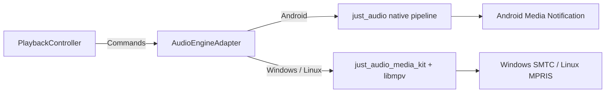
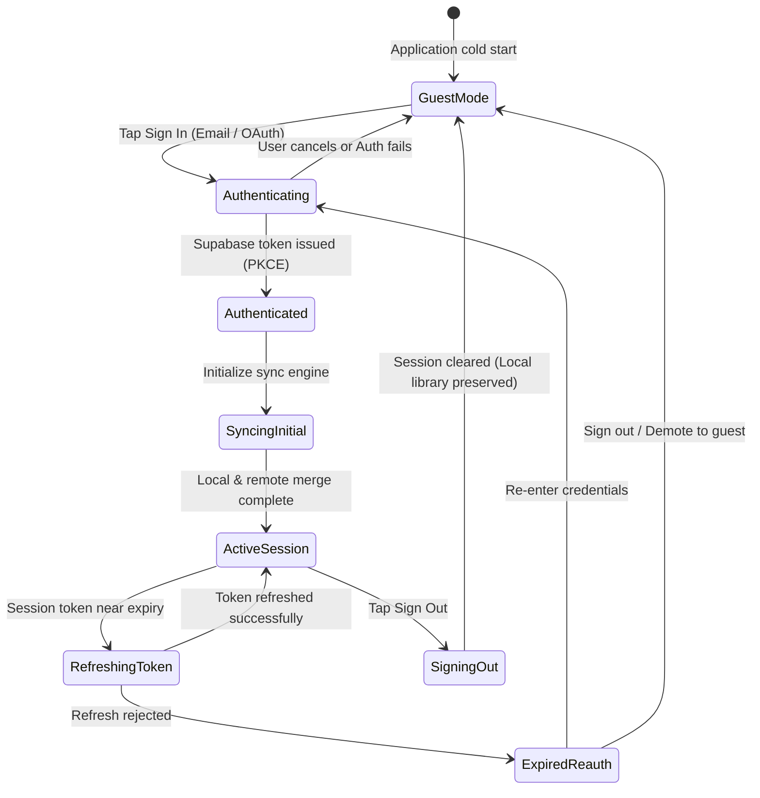
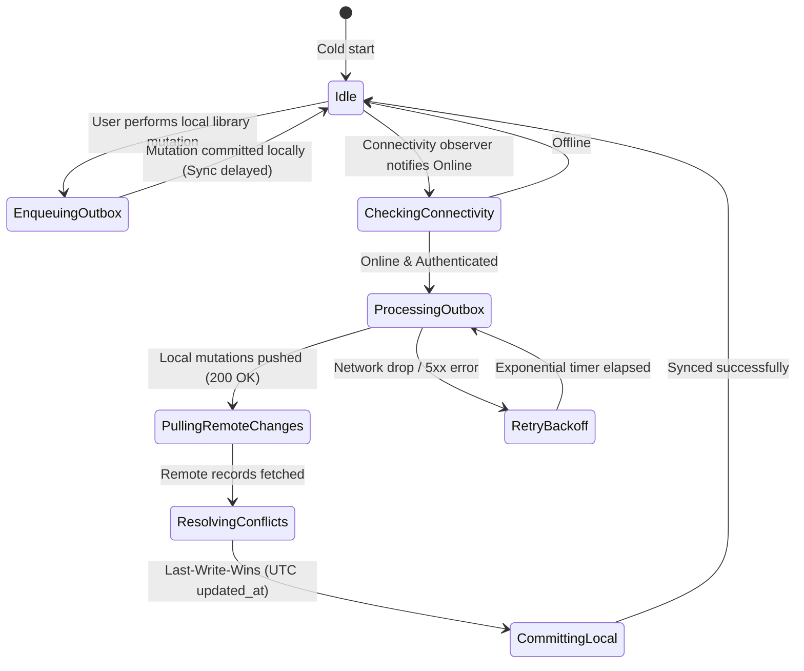
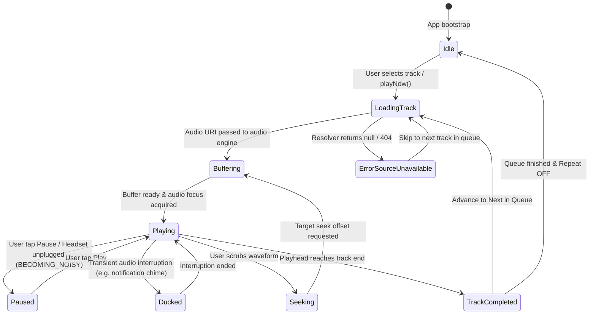
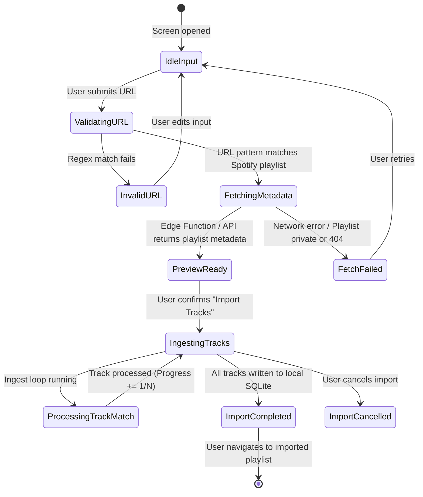
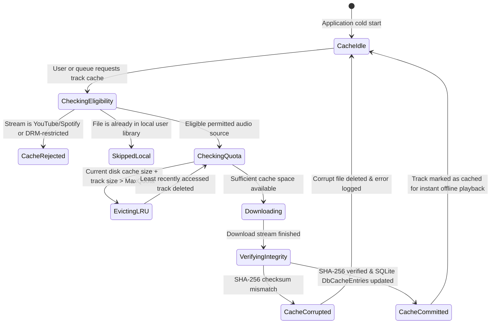
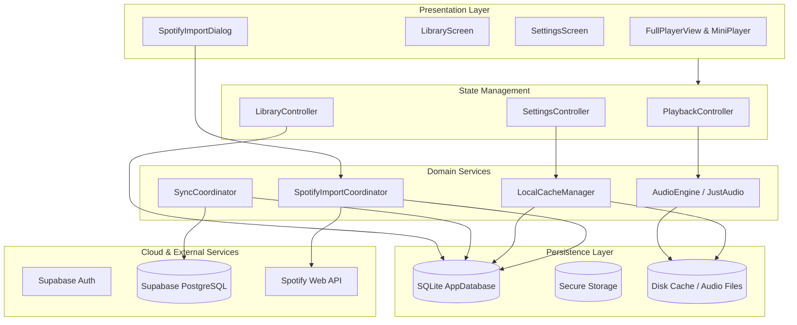

# Cavia Music — Backend Architecture & System Design

## 1. Architectural Philosophy: Local-First & Provider-Agnostic

Cavia Music is engineered around a **local-first, reactive architecture**. The primary database lives directly on the user's client device. The application delivers instantaneous UI responsiveness, zero network latency on local actions, 100% offline playback capability, and optional non-blocking cloud backup via **Supabase**.

```
┌────────────────────────────────────────────────────────────────────────┐
│                          PRESENTATION LAYER                            │
│  LibraryScreen • SearchScreen • FullPlayerView • QueueSheet • Settings │
└───────────────────────────────────┬────────────────────────────────────┘
                                    │ Observables & Intent Calls
┌───────────────────────────────────▼────────────────────────────────────┐
│                    UI CONTROLLERS (STATE MANAGEMENT)                   │
│   PlaybackController   •   LibraryController   •   SettingsController  │
└───────────────────────────────────┬────────────────────────────────────┘
                                    │ Depends on Abstract Interfaces
┌───────────────────────────────────▼────────────────────────────────────┐
│                     DOMAIN & REPOSITORY INTERFACES                     │
│  ITrackRepository   •   IPlaylistRepository   •   ISettingsRepository  │
│  IAuthRepository    •   ISyncRepository       •   IAudioEngineAdapter  │
└───────────────┬──────────────────────────────────────────┬─────────────┘
                │ Concrete Implementations                 │
┌───────────────▼─────────────────┐       ┌────────────────▼─────────────┐
│      LOCAL PERSISTENCE LAYER    │       │     CLOUD & REMOTE LAYER     │
│ • Drift (SQLite Relational DB)  │       │ • Supabase Auth (PKCE)       │
│ • SecureStorage (Auth Tokens)   │       │ • Supabase PostgreSQL (RLS)  │
│ • Disk Cache (Audio & Artwork)  │       │ • Supabase Edge Functions    │
│ • Offline Mutation Outbox Table │       │ • LRCLIB / MusicBrainz APIs  │
└─────────────────────────────────┘       └──────────────────────────────┘
```

---

## 2. Core Architectural Decisions

### 2.1 Local Database Selection: Drift (SQLite) vs. Hive vs. Isar
- **Evaluation**: While Hive was used in the legacy prototype for key-value caching, music libraries require strict relational integrity (many-to-many playlist-track associations, foreign-key constraints, cascading deletes, indexable full-text search, and schema migrations).
- **Decision**: **Drift (Type-safe SQLite)** is the primary local database engine.
  - **Benefits**: Compile-time SQL safety, cross-platform support across Android, Windows, and Linux, ACID transaction compliance, automatic schema migration tooling, and reactive Dart `Stream` queries.
  - **Secure Storage**: `flutter_secure_storage` is used exclusively for sensitive Supabase refresh tokens and encryption keys.
  - **Binary File Storage**: Cached audio files and downloaded cover art reside directly in the OS application cache directory managed via `path_provider` and tracked by disk-path references in SQLite.

### 2.2 Cloud & Backend: Supabase
- **Zero Standalone Servers**: In accordance with project restrictions, Cavia Music avoids maintaining self-hosted microservices or secondary application servers.
- **Supabase Auth**: Non-blocking authentication supporting Email Magic Links and Google OAuth via PKCE.
- **Supabase PostgreSQL & Row-Level Security (RLS)**: User tables are partitioned so that authenticated users can strictly query and mutate records matching their `auth.uid()`.
- **Supabase Edge Functions (Deno / TypeScript)**: Utilized solely for operations that require secure server execution without exposing client secrets (e.g., Spotify client credentials token rotation).

### 2.3 Layered Repository & Adapter Pattern
- **Decoupling**: UI controllers (`PlaybackController`, `LibraryController`) are completely decoupled from database queries, network sockets, or audio drivers.
- **Repositories**: All data access is mediated through abstract repository interfaces:
  - `TrackRepository`: CRUD for local tracks, favorites, and play-counts.
  - `PlaylistRepository`: Playlist creation, metadata editing, track reordering, and deletion.
  - `SyncRepository`: Outbox queueing, network state detection, and remote conflict resolution.
  - `AudioEngineAdapter`: Hardware audio playback coordination.

---

## 3. Audio Engine & Provider Architecture

### 3.1 Audio Hardware & Driver Pipeline
To ensure cross-platform parity without compromise:
- **Android**: Utilizes the native Android ExoPlayer pipeline managed through `just_audio` and `audio_service`, handling OS notification controls and media button intents.
- **Windows & Linux**: Driven by `just_audio_media_kit` backed by bundled `libmpv` binaries, providing hardware-accelerated audio decoding, Windows System Media Transport Controls (`smtc_windows`), and Linux MPRIS integration (`audio_service_mpris`).



### 3.2 Pluggable Source Resolution Adapter (`AudioSourceAdapter`)
- Audio resolution follows an adapter-based interface (`IAudioSourceAdapter`):
  ```dart
  abstract class IAudioSourceAdapter {
    String get providerId;
    Future<bool> isAvailable();
    Future<ResolvedAudioStream?> resolveStream(SongQuery query);
  }
  ```
- **Policy Compliance**: Only sanctioned, official API sources or direct local files are executed. Third-party scraping, undocumented stream extraction, or methods that bypass platform authentication are strictly prohibited. Where an audio stream is unavailable through legal channels, the resolver fails gracefully and logs an honest unsupported state.

---

## 4. State-Machine Specifications

### 4.1 Authentication State Machine
Governs optional user identity lifecycle:



---

### 4.2 Synchronization & Conflict Resolution State Machine
Manages offline mutation queue and two-way cloud replication:



---

### 4.3 Audio Playback Engine State Machine
Governs playback states, buffering, interruptions, and track transitions:



---

### 4.4 Spotify Playlist Importing State Machine
Simulates and manages the focused import workflow:



---

### 4.5 Storage & Offline Caching State Machine
Governs download scheduling, quota enforcement, SHA-256 integrity checks, and LRU cache eviction:



---

## 5. Security, Redaction & Technical Logging Architecture

Cavia Music incorporates a privacy-first logging subsystem (`CaviaLogger`) designed to prevent accidental leakage of sensitive credentials, tokens, or PII into console outputs, log sinks, or crash reporting buffers.

```
┌────────────────────────────────────────────────────────┐
│                   APPLICATION LOG SINK                 │
│         Repositories • Audio Engine • Sync Outbox      │
└───────────────────────────┬────────────────────────────┘
                            │ Raw log string / error
┌───────────────────────────▼────────────────────────────┐
│                  CAVIA LOGGER REDACTION                │
│  • Bearer & OAuth tokens → [REDACTED_BEARER_TOKEN]     │
│  • Client Secrets & Keys → [REDACTED_SECRET]           │
│  • User Email Addresses  → [REDACTED_EMAIL]            │
│  • Home Directory Paths  → ~/...                       │
│  • Raw SQL syntax errors → Sanitized database error    │
└───────────────────────────┬────────────────────────────┘
                            │ Clean, audited message
┌───────────────────────────▼────────────────────────────┐
│                    SAFE LOG STREAMS                    │
│    Debug Console (Dev)   •   Persistent Diagnostics    │
└────────────────────────────────────────────────────────┘
```

### Redaction Rules:
1. **Bearer / OAuth Tokens**: Patterns matching `Bearer [A-Za-z0-9_\-\.]+` or `access_token=[^&\s]+` are masked.
2. **Secrets & Keys**: Keys labelled `secret`, `client_secret`, `private_key`, or Supabase service keys are replaced with `[REDACTED_SECRET]`.
3. **User PII**: Email addresses matching standard RFC formats are scrubbed to `[REDACTED_EMAIL]`.
4. **Filesystem User Paths**: Operating system home paths (`C:\Users\username\` or `/home/username/`) are normalized to `~/...` to prevent leaking local user accounts.
5. **Raw Database Errors**: SQLite driver syntax errors or SQL query statements are caught and mapped to domain-level descriptions without logging SQL statements containing personal data.

---

## 6. End-to-End System Connectivity & Dependency Map

The overall system interactions across layers are summarized below:



