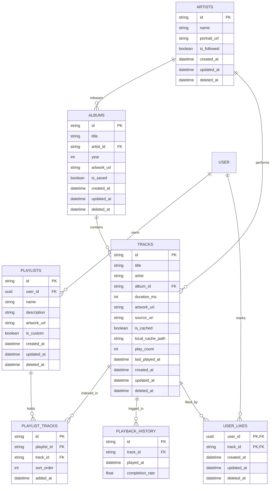

# Cavia Music — Data Models & Storage Schema

## 1. Overview & Data Philosophy

Cavia Music employs a dual-tier storage strategy:
1. **Client Storage (Drift / SQLite)**: Complete normalized relational schema with local indexing, fast queries, and an ACID mutation outbox.
2. **Cloud Storage (Supabase / PostgreSQL)**: Mirror schema scoped to authenticated user IDs (`auth.uid()`) protected by Row-Level Security (RLS) policies.

Both schemas use soft-deletes (`deleted_at TIMESTAMP WITH TIME ZONE NULL`) and UTC timestamps (`updated_at`) to enable deterministic conflict resolution via Last-Write-Wins (LWW).

---

## 2. Entity-Relationship Diagram



---

## 3. Local SQLite Schema (Drift Table Definitions)

### 3.1 Tracks Table
```sql
CREATE TABLE tracks (
    id TEXT PRIMARY KEY NOT NULL,
    title TEXT NOT NULL,
    artist TEXT NOT NULL,
    album_id TEXT REFERENCES albums(id) ON DELETE SET NULL,
    duration_ms INTEGER NOT NULL,
    artwork_url TEXT NOT NULL,
    source_uri TEXT,
    is_cached INTEGER NOT NULL DEFAULT 0,
    local_cache_path TEXT,
    play_count INTEGER NOT NULL DEFAULT 0,
    last_played_at INTEGER, -- Epoch milliseconds
    created_at INTEGER NOT NULL,
    updated_at INTEGER NOT NULL,
    deleted_at INTEGER
);

CREATE INDEX idx_tracks_artist ON tracks(artist);
CREATE INDEX idx_tracks_updated_at ON tracks(updated_at);
```

### 3.2 Playlists & Playlist Tracks Tables
```sql
CREATE TABLE playlists (
    id TEXT PRIMARY KEY NOT NULL,
    name TEXT NOT NULL,
    description TEXT NOT NULL DEFAULT '',
    artwork_url TEXT NOT NULL,
    is_custom INTEGER NOT NULL DEFAULT 1,
    created_at INTEGER NOT NULL,
    updated_at INTEGER NOT NULL,
    deleted_at INTEGER
);

CREATE TABLE playlist_tracks (
    id TEXT PRIMARY KEY NOT NULL,
    playlist_id TEXT NOT NULL REFERENCES playlists(id) ON DELETE CASCADE,
    track_id TEXT NOT NULL REFERENCES tracks(id) ON DELETE CASCADE,
    sort_order INTEGER NOT NULL,
    added_at INTEGER NOT NULL,
    UNIQUE(playlist_id, track_id)
);

CREATE INDEX idx_playlist_tracks_order ON playlist_tracks(playlist_id, sort_order);
```

### 3.3 Albums and Artists Tables
```sql
CREATE TABLE artists (
    id TEXT PRIMARY KEY NOT NULL,
    name TEXT NOT NULL,
    portrait_url TEXT NOT NULL,
    is_followed INTEGER NOT NULL DEFAULT 0,
    created_at INTEGER NOT NULL,
    updated_at INTEGER NOT NULL,
    deleted_at INTEGER
);

CREATE TABLE albums (
    id TEXT PRIMARY KEY NOT NULL,
    title TEXT NOT NULL,
    artist_id TEXT REFERENCES artists(id) ON DELETE SET NULL,
    year INTEGER NOT NULL,
    artwork_url TEXT NOT NULL,
    is_saved INTEGER NOT NULL DEFAULT 0,
    created_at INTEGER NOT NULL,
    updated_at INTEGER NOT NULL,
    deleted_at INTEGER
);
```

### 3.4 Local Offline Mutation Outbox Table
Tracks pending remote synchronization when offline:
```sql
CREATE TABLE sync_outbox (
    id TEXT PRIMARY KEY NOT NULL,
    entity_type TEXT NOT NULL, -- 'track', 'playlist', 'playlist_track', 'like'
    entity_id TEXT NOT NULL,
    operation TEXT NOT NULL,   -- 'INSERT', 'UPDATE', 'DELETE'
    payload_json TEXT NOT NULL,
    created_at INTEGER NOT NULL,
    attempt_count INTEGER NOT NULL DEFAULT 0,
    last_attempt_at INTEGER,
    status TEXT NOT NULL DEFAULT 'PENDING' -- 'PENDING', 'IN_FLIGHT', 'FAILED'
);

CREATE INDEX idx_sync_outbox_status ON sync_outbox(status, created_at);
```

### 3.5 App Settings & Search History
```sql
CREATE TABLE app_settings (
    key TEXT PRIMARY KEY NOT NULL,
    value TEXT NOT NULL,
    updated_at INTEGER NOT NULL
);

CREATE TABLE search_history (
    id TEXT PRIMARY KEY NOT NULL,
    query TEXT NOT NULL UNIQUE,
    created_at INTEGER NOT NULL
);

CREATE INDEX idx_search_history_created ON search_history(created_at DESC);
```

### 3.6 Offline Audio Cache Metadata Table (Schema v3)
Tracks cached audio files on local disk, their cryptographic SHA-256 integrity hashes, byte sizes, and access timestamps for LRU eviction:
```sql
CREATE TABLE db_cache_entries (
    track_id TEXT PRIMARY KEY NOT NULL REFERENCES db_tracks(id) ON DELETE CASCADE,
    file_path TEXT NOT NULL,
    file_size_bytes INTEGER NOT NULL,
    sha256_hash TEXT NOT NULL,
    created_at INTEGER NOT NULL,
    last_accessed_at INTEGER NOT NULL
);

CREATE INDEX idx_cache_last_accessed ON db_cache_entries(last_accessed_at ASC);
CREATE INDEX idx_cache_track_id ON db_cache_entries(track_id);
```

---

## 4. Cloud Schema (Supabase PostgreSQL & RLS Policies)

```sql
-- Enable UUID extension
CREATE EXTENSION IF NOT EXISTS "uuid-ossp";

-- Cloud Playlists Table
CREATE TABLE public.playlists (
    id TEXT PRIMARY KEY,
    user_id UUID NOT NULL REFERENCES auth.users(id) ON DELETE CASCADE DEFAULT auth.uid(),
    name TEXT NOT NULL,
    description TEXT DEFAULT '',
    artwork_url TEXT NOT NULL,
    is_custom BOOLEAN DEFAULT TRUE,
    created_at TIMESTAMPTZ NOT NULL DEFAULT timezone('utc'::text, now()),
    updated_at TIMESTAMPTZ NOT NULL DEFAULT timezone('utc'::text, now()),
    deleted_at TIMESTAMPTZ DEFAULT NULL
);

-- Row-Level Security for Playlists
ALTER TABLE public.playlists ENABLE ROW LEVEL SECURITY;

CREATE POLICY "Users can view own playlists"
    ON public.playlists FOR SELECT
    USING (auth.uid() = user_id);

CREATE POLICY "Users can insert own playlists"
    ON public.playlists FOR INSERT
    WITH CHECK (auth.uid() = user_id);

CREATE POLICY "Users can update own playlists"
    ON public.playlists FOR UPDATE
    USING (auth.uid() = user_id);

CREATE POLICY "Users can delete own playlists"
    ON public.playlists FOR DELETE
    USING (auth.uid() = user_id);

-- Cloud Playlist Tracks Table
CREATE TABLE public.playlist_tracks (
    id TEXT PRIMARY KEY,
    user_id UUID NOT NULL REFERENCES auth.users(id) ON DELETE CASCADE DEFAULT auth.uid(),
    playlist_id TEXT NOT NULL REFERENCES public.playlists(id) ON DELETE CASCADE,
    track_id TEXT NOT NULL,
    sort_order INTEGER NOT NULL,
    added_at TIMESTAMPTZ NOT NULL DEFAULT timezone('utc'::text, now()),
    updated_at TIMESTAMPTZ NOT NULL DEFAULT timezone('utc'::text, now()),
    deleted_at TIMESTAMPTZ DEFAULT NULL
);

ALTER TABLE public.playlist_tracks ENABLE ROW LEVEL SECURITY;

CREATE POLICY "Users can manage own playlist tracks"
    ON public.playlist_tracks FOR ALL
    USING (auth.uid() = user_id)
    WITH CHECK (auth.uid() = user_id);

-- User Liked Tracks Table
CREATE TABLE public.user_likes (
    user_id UUID NOT NULL REFERENCES auth.users(id) ON DELETE CASCADE DEFAULT auth.uid(),
    track_id TEXT NOT NULL,
    created_at TIMESTAMPTZ NOT NULL DEFAULT timezone('utc'::text, now()),
    updated_at TIMESTAMPTZ NOT NULL DEFAULT timezone('utc'::text, now()),
    deleted_at TIMESTAMPTZ DEFAULT NULL,
    PRIMARY KEY (user_id, track_id)
);

ALTER TABLE public.user_likes ENABLE ROW LEVEL SECURITY;

CREATE POLICY "Users can manage own likes"
    ON public.user_likes FOR ALL
    USING (auth.uid() = user_id)
    WITH CHECK (auth.uid() = user_id);
```

---

## 5. Migration & Normalization Strategy

### 5.1 Local Drift SQLite Migration Lifecycle
Drift's transactional `MigrationStrategy` safely evolves the local database schema without data loss:
- **Version 1 (Initial Release)**:
  - Base schema initialized with core tables: `db_tracks`, `db_artists`, `db_albums`, `db_playlists`, `db_playlist_tracks`, `db_liked_tracks`, and `db_app_settings`.
  - Default system playlists (`Favorites`, `Recently Played`) created with `isSystem = true`.
- **Version 2 (Outbox & Search Extensions)**:
  - Added `sync_outbox` table with status indexes for queuing offline mutations.
  - Added `search_history` table with unique constraint on `query` and descending index on `created_at`.
- **Version 3 (Offline Audio Cache Support)**:
  - Added `db_cache_entries` table with foreign key reference `track_id REFERENCES db_tracks(id) ON DELETE CASCADE`.
  - Created indexes `idx_cache_last_accessed` and `idx_cache_track_id` for efficient LRU eviction sweeps.
  - Verification: Schema migration test suite asserts clean step-by-step upgrade path ($1 \to 2 \to 3$) and schema validation.

### 5.2 Conflict Resolution & Tombstones
- **Soft-Delete Propagation**: Records deleted on client or server are marked with `deleted_at = now()`. A monthly cleanup cron purges soft-deleted records older than 60 days on both client and cloud.
- **Tombstone Guarantee**: Deleted tracks or playlists generate tombstones in the local database and outbox. A later remote sync never resurrects a tombstoned entity unless the remote modification timestamp is demonstrably newer than the local deletion timestamp.
- **Payload Serialization**: Outbox payloads are stored as serialized JSON maps and checked against schema version headers before syncing.

