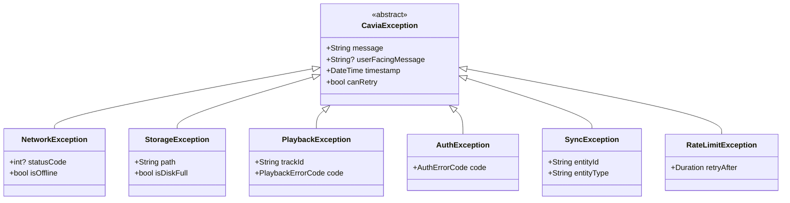
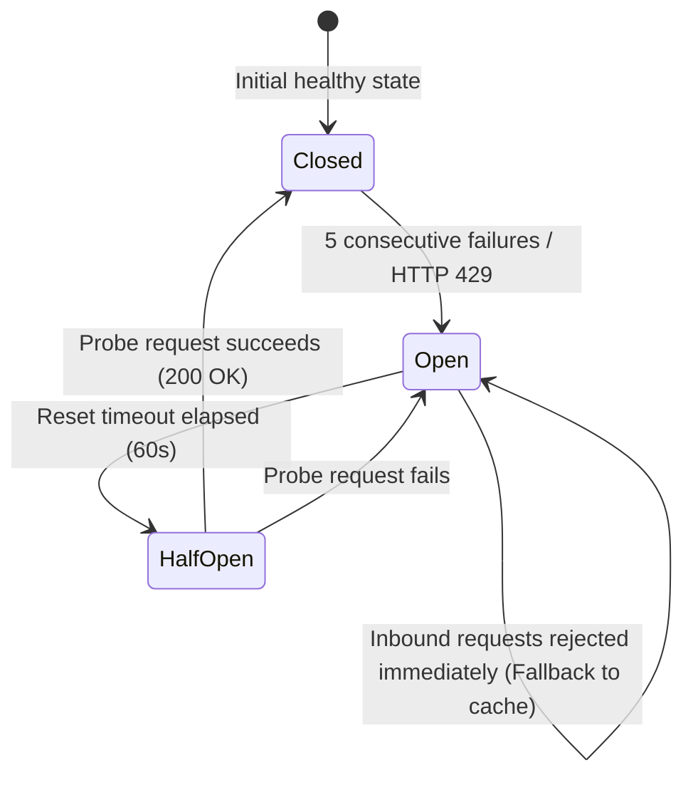

# Cavia Music — Error Handling & Resilience Strategy

## 1. Error Taxonomy & Classification

All errors in Cavia Music inherit from a sealed hierarchy of domain exceptions (`CaviaException`). Business logic, data repositories, and audio adapters throw typed domain exceptions rather than leaking raw socket, database, or platform errors to UI controllers.

---

## 2. Comprehensive Error Matrix & Exact User-Facing Messages

Cavia Music enforces strict separation between internal diagnostics and user-facing messages. Raw stack traces, SQL error codes, or provider error bodies are **never** displayed to users.

### 2.1 Playback Failure UI Messages (`PlaybackFailure`)

| Failure Type | Root Cause / Scenario | Exact User-Facing Message | System Behavior |
| :--- | :--- | :--- | :--- |
| **`networkUnavailable`** | Network dropped during playback request | `"Connection lost."` | Halts buffering, surfaces non-blocking status |
| **`notCachedForOffline`** | User offline and track not in local cache | `"This track isn't cached for offline playback."` | Prevents stalling; advances queue if continuous |
| **`trackUnavailable`** | Track 404, deleted upstream, or unplayable | `"This track isn't available."` | Skips to next track in queue |
| **`playbackUnsupported`** / **`permissionDenied`** | DRM stream, YouTube audio-only stream, or unauthorized | `"Playback isn't supported for this source."` | Explains policy boundary without false extraction |
| **`authenticationExpired`** | Expired OAuth/Session token | `"Reconnect this music source to continue."` | Prompts for non-blocking re-authentication |
| **`regionRestricted`** | Geoblocked content from external source | `"This track isn't available in your region."` | Skips track; logs provider restriction |
| **`sourceUnavailable`** | Resolver found no playable stream/file | `"No playable source was found."` | Offers manual search or alternative source |
| **`requestTimeout`** / **`rateLimited`** / **`invalidMedia`** | Server 5xx, 429 rate limit, or socket timeout | `"Couldn't start playback. Try again."` | Exponential backoff retry |

### 2.2 Storage & Domain Error UI Messages (`AppError`)

| Error Class | Trigger Scenario | Exact User-Facing Message | System Behavior |
| :--- | :--- | :--- | :--- |
| **`ValidationError`** | Empty playlist name or malformed URL | `"[Validation message]"` (e.g., `"Playlist name cannot be empty"`) | Prevents invalid write; keeps form open |
| **`NotFoundError`** | Playlist or track ID missing in SQLite | `"Playlist not found"` or `"Track not found"` | Cleans up UI selection gracefully |
| **`DuplicateError`** | Inserting duplicate item or unique key conflict | `"[Entity] already exists"` | Prevents duplicate record insertion |
| **`DatabaseError`** | SQLite transaction abort, disk locked | `"Couldn't save changes"` | Rolls back transaction; retries safely |
| **`StorageError`** | Disk full or filesystem permission error | `"Storage unavailable"` | Halts write/download; keeps existing data intact |
| **`OperationProhibitedError`** | User attempts to delete system playlist (e.g. Liked Songs) | `"System playlists cannot be deleted."` | Rejects mutation; preserves core system playlists |

### 2.3 Cloud Synchronization & Network Error Handling

| Scenario | HTTP Status / Exception | System Behavior | User Presentation |
| :--- | :--- | :--- | :--- |
| **Offline Guest** | No network connection | Sync engine suspends all outbox processing | Non-intrusive offline icon in Settings |
| **Token Expiry** | HTTP 401 Unauthorized | Gracefully demotes session to Guest; preserves local data | `"Cloud session expired. Please sign in again to sync."` |
| **Rate Limit** | HTTP 429 Too Many Requests | Pauses outbound synchronization for `Retry-After` seconds | Non-intrusive banner in Settings |
| **Conflict (LWW)** | Simultaneous edits across 2 devices | Last-Write-Wins based on UTC `updated_at` | Silent deterministic local resolution |
| **Tombstones** | Deleted item synced from another device | Local tombstone prevents resurrection of deleted items | Item stays deleted across all devices |

---

## 3. Resilience Algorithms & Retry Policies

### 3.1 Exponential Backoff with Jitter
To prevent thundering herd spikes when recovering from network outages, all network and sync retry operations utilize full jitter:

$$t_{\text{wait}} = \min(t_{\text{max}},\, t_{\text{base}} \times 2^{\text{attempt}}) \times \text{random}(0.5,\, 1.5)$$

- Default parameters: $t_{\text{base}} = 1.5\text{s}$, $t_{\text{max}} = 60\text{s}$, $\text{MaxAttempts} = 5$.

### 3.2 Circuit Breaker Pattern
External metadata endpoints (LRCLIB, MusicBrainz, Spotify Resolver) are protected by a 3-state circuit breaker:

---

## 4. Design-System Consistent Error Presentation

In accordance with the **Japanese Ink × Liquid Glass** design aesthetic:
- **Never display raw stack traces or debug text** to the user.
- **Translucent Error Toasts**: Displayed using `CaviaToast.show()` with a glowing vermilion status dot (`CaviaColors.vermilionBright`).
- **Confirmation & Warning Dialogs**: Rendered using `CaviaDialog.show()` featuring frosted glass surfaces (`BackdropFilter`), aged ivory headings, and vermilion action buttons.
- **Empty & Error View States**: Rendered within the view hierarchy using understated sumi-e line art and calm, dignified copy.

---

## 5. Security & Privacy Redaction During Error Logging

When unexpected errors occur or internal failures are captured, all diagnostic information is filtered through `CaviaLogger.sanitize()` prior to reaching any log handler:
1. **Bearer & Access Tokens**: Any token string (`Bearer ...`, `token=...`) is scrubbed to `[REDACTED_BEARER_TOKEN]`.
2. **Secrets & Passwords**: Any parameter key containing `secret`, `password`, `service_role`, or `api_key` is replaced with `[REDACTED_SECRET]`.
3. **User Email Addresses**: RFC 5322 email patterns are converted to `[REDACTED_EMAIL]`.
4. **Local Paths & Usernames**: File paths matching `C:\Users\username\...` or `/home/username/...` are sanitized to `~/...`.
5. **Raw SQL Exceptions**: SQLite syntax or constraint exceptions are converted to sanitized high-level database diagnostics without logging executed SQL statements that may contain user metadata.

