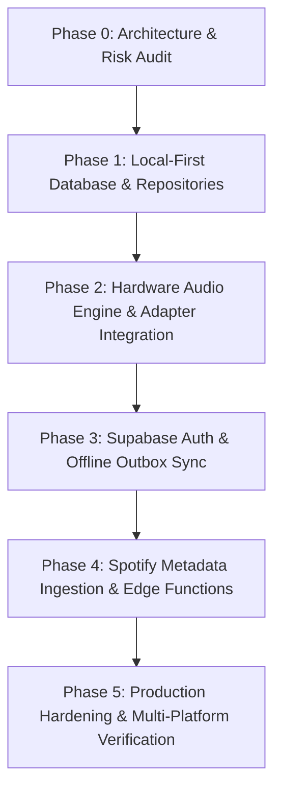

# Cavia Music — Backend Implementation Plan

## 1. Roadmap Overview & Phasing

---

## 2. Phase-by-Phase Execution Plan

### Phase 1: Local-First Database & Repository Layer
**Objective**: Replace in-memory mock collections with a persistent, type-safe SQLite database (Drift) wrapped behind clean repository interfaces.

- **Tasks**:
  1. Add dependencies: `drift`, `sqlite3_flutter_libs`, `path_provider`, `path`. Add dev dependencies: `drift_dev`, `build_runner`.
  2. Implement Drift database schema (`CaviaDatabase`) with tables: `tracks`, `albums`, `artists`, `playlists`, `playlist_tracks`, `search_history`, `app_settings`, and `sync_outbox`.
  3. Author Data Access Objects (DAOs): `TrackDao`, `PlaylistDao`, `SettingsDao`.
  4. Implement repository layer:
     - `TrackRepository`: Queries tracks, reactive streams for Liked Songs, update play counts.
     - `PlaylistRepository`: CRUD operations for playlists and playlist tracks.
     - `SettingsRepository`: Persist user preferences (caching toggle, accent color, audio quality).
  5. Refactor `LibraryController` and `SettingsController` to depend on these repository interfaces via constructor injection.
  6. Populate the database on initial launch with seeded default items ("Afterglow", "Zenith", "Crimson Shrine").

- **Verification Criteria**:
  - `flutter test`: All existing unit and widget tests pass against the SQLite repository.
  - Changes to playlists or liked tracks survive application restart.
  - Disabling offline caching does not purge existing database records or files.

---

### Phase 2: Hardware Audio Engine & Adapter Integration
**Objective**: Connect `PlaybackController` to real hardware audio drivers across Android, Windows, and Linux while preserving zero-delay UI responsiveness.

- **Tasks**:
  1. Add audio dependencies: `just_audio`, `just_audio_media_kit`, `audio_service`, `smtc_windows`, `audio_service_mpris`.
  2. Implement `AudioEngineAdapter`:
     - Mobile: Initialize native `just_audio` + `audio_service` background isolate.
     - Desktop: Initialize `just_audio_media_kit` backed by bundled `libmpv`.
  3. Implement `AudioSourceAdapter` interface:
     - Local File Adapter: Reads and plays files from device storage or cache directory.
     - Remote HTTPS Stream Adapter: Streams compliant public audio streams with buffering telemetry.
  4. Configure OS Media Controls:
     - Android: Configure foreground notification service, lock screen artwork, and `BECOMING_NOISY` broadcast receiver.
     - Windows: Bind `smtc_windows` to Windows 10/11 system media flyout.
     - Linux: Bind `audio_service_mpris` to D-Bus interface.
  5. Wire live audio stream progress and duration into `PlaybackController` (replacing the simulated timer with real driver position streams).

- **Verification Criteria**:
  - Audio plays continuously in the background on Android with lock-screen notification controls.
  - Windows media keys (Play/Pause, Previous, Next) control playback.
  - Unplugging headphones automatically pauses playback (`BECOMING_NOISY`).

---

### Phase 3: Supabase Auth & Offline Outbox Sync
**Objective**: Implement optional cloud accounts and reliable, conflict-free two-way library synchronization.

- **Tasks**:
  1. Add dependencies: `supabase_flutter`, `flutter_secure_storage`, `connectivity_plus`.
  2. Configure Supabase client in non-blocking mode; initialize with credentials injected via `--dart-define`.
  3. Implement `AuthRepository`:
     - Email Magic Link and Google OAuth via PKCE (`caviamusic://auth/callback`).
     - Token storage backed by `flutter_secure_storage`.
     - Guest mode fallback: app remains 100% usable without authentication.
  4. Implement `SyncRepository` & `OutboxProcessor`:
     - Intercept local repository mutations (like track, create/delete playlist) and insert a change record into `sync_outbox`.
     - Monitor connectivity state via `connectivity_plus`.
     - When online and authenticated, push pending outbox mutations to Supabase PostgreSQL using Last-Write-Wins (LWW) timestamp comparisons.
     - Pull remote changes and update local SQLite tables.

- **Verification Criteria**:
  - Liking tracks while offline stages mutations in `sync_outbox`.
  - Reconnecting to Wi-Fi pushes mutations to Supabase and clears outbox.
  - Logging into the same account on a second device replicates playlists and liked songs.

---

### Phase 4: Spotify Metadata Ingestion & Edge Functions
**Objective**: Implement the Spotify playlist migration pipeline using official APIs and Supabase Edge Functions.

- **Tasks**:
  1. Create a Supabase Edge Function (`spotify-resolver`) in TypeScript/Deno:
     - Implements Spotify Client Credentials OAuth flow on the server (keeping secret keys off client binaries).
     - Fetches public playlist metadata, tracks, artwork, and ISRC codes.
     - Returns a normalized JSON payload: `{ name, owner, track_count, tracks: [...] }`.
  2. Implement client-side `SpotifyImportCoordinator`:
     - Validates input URL pattern (`open.spotify.com/playlist/...`).
     - Calls `spotify-resolver` Edge Function to fetch preview.
     - Simulates / processes track cross-matching against local and available catalogues.
     - Writes resolved tracks into a newly created local playlist.
  3. Wire the real import workflow to `SpotifyImportScreen` (`PAGE 10`).

- **Verification Criteria**:
  - Valid public Spotify playlist URL renders a rich preview card with track count and cover art.
  - Private or invalid URLs display graceful error messages.
  - Tapping "Import Tracks" saves the playlist into the local SQLite library without crashes.

---

### Phase 5: Production Hardening, Logging & Verification
**Objective**: End-to-end stress testing, memory profiling, and platform packaging.

- **Tasks**:
  1. Database Stress Testing: Verify WAL mode handles 5,000+ tracks without UI frame drops.
  2. Memory Profiling: Verify `libmpv` and image cache are disposed cleanly during long listening sessions.
  3. Platform Packaging:
     - Android: Configure release signing, ProGuard rules, and permissions (`FOREGROUND_SERVICE`, `WAKE_LOCK`).
     - Windows: Configure release executable packaging via `distribute_options.yaml`.
     - Linux: Verify runtime dependencies (`libmpv1`, `libgtk-3-0`).
  4. Automated Test Suite Expansion: Full mock integration tests for the new repositories and adapters.

- **Verification Criteria**:
  - App cold boot to responsive Library under 500ms.
  - Zero memory leaks detected after playing 50 consecutive tracks.
  - Clean build output on Android, Windows, and Linux.

